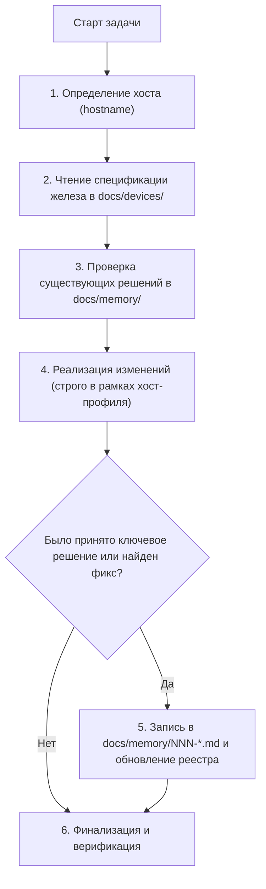

# Инструкция для AI-агентов (AGENTS.md)

Добро пожаловать в репозиторий `dotfiles`. Этот документ определяет правила взаимодействия, рабочий процесс (workflow), контекст оборудования и архитектурные стандарты, которым обязан следовать любой AI-агент при работе с данной системой.

---

## 🧭 Философия и контекст пользователя

1. **Пользователь в основном не трогает систему вручную.**  
   Вся системная инженерия, траблшутинг, модификация конфигов, оптимизация и написание скриптов выполняются **тобой (агентом)**.
2. **Агент обязан сохранять память о системе.**  
   Недопустимо каждый раз заново «переизобретать» контекст, гадать о характеристиках железа или забывать, почему то или иное решение было принято. Все важные решения и аппаратные ограничения зафиксированы в `docs/`.
3. **Безопасность и стабильность окружения — наивысший приоритет.**  
   Правка конфигов на одном устройстве не должна ломать другое устройство. Изменения должны быть изолированными и обратимыми.

---

## 💻 Устройства пользователя

Текущая конфигурация рассчитана на мультихостовую работу с перспективой перехода на единое универсальное устройство:

| Идентификатор хоста | Тип устройства | Статус | Документация со спецификацией |
| :--- | :--- | :--- | :--- |
| **`cachyos-pc`** (`desktop`) | Рабочая станция (Dual Monitor, Nvidia GTX 1060, Limine, Btrfs) | Активно (текущий ПК) | [docs/devices/desktop/README.md](file:///home/michael/dotfiles/docs/devices/desktop/README.md) |
| **`laptop`** (`macbook`) | MacBook Pro 15" Mid-2015 Retina (Dual GPU AMD/Intel, Apple GMUX) | Активно (ноутбук) | [docs/devices/macbook/README.md](file:///home/michael/dotfiles/docs/devices/macbook/README.md) |
| **`future-laptop`** | Xiaomi Book Pro 14 (2026) [Intel Core Ultra X7 358H / Arc B390 / OLED 3.1K] | **Запланировано** (на замену двум текущим) | [docs/devices/future-xiaomi-book-pro-14/README.md](file:///home/michael/dotfiles/docs/devices/future-xiaomi-book-pro-14/README.md) |

> 📌 **База знаний по новому устройству:** Детальные аппаратные спецификации, реверс-инжиниринг EC/WMI и драйверы для будущего ноутбука собраны в отдельном проекте: [/home/michael/Projects/xiaomi-book-pro-14-2026/](file:///home/michael/Projects/xiaomi-book-pro-14-2026/).

---

## 🔄 Рабочий процесс агента (Workflow)

При выполнении любой задачи агент следует строгому алгоритму:



### 1. Определение текущего хоста
Всегда первым делом проверяй, на каком устройстве ты находишься:
```bash
hostname 2>/dev/null || cat /etc/hostname 2>/dev/null
```
- Если `cachyos-pc` $\to$ применяются профили `desktop`.
- Если иное (MacBook) $\to$ профили `laptop`.

### 2. Мультихостовая изоляция (Никаких хардкодов!)
Категорически запрещено прописывать специфичные для конкретного оборудования вещи (разрешение мониторов, scaling, драйверы GPU, горячие клавиши специфичных клавиатур) в общие файлы конфигурации.
Всегда используй структуру профилей хостов:
* **Hyprland:** `hypr/.config/hypr/hosts/<profile>.lua` (подключается динамически в `hyprland.lua` или через симлинк `host.lua`).
* **Waybar:** `waybar/.config/waybar/hosts/<profile>.json` и `.css`.
* **Alacritty:** `alacritty/.config/alacritty/hosts/<profile>.toml`.
* **Dunst:** `dunst/.config/dunst/hosts/<profile>.conf`.
* **Zed:** `zed/.config/zed/hosts/<profile>.json`.

### 3. Готовность к миграции на новое устройство (Decoupling)
Пользователь планирует продать оба текущих устройства (ПК и MacBook) и перейти на один ультрабук (Xiaomi Book Pro 14 2026).  
* Все скрипты развёртывания ([bootstrap.sh](file:///home/michael/dotfiles/bootstrap.sh)) и конфиги должны быть написаны так, чтобы при появлении нового хоста достаточно было добавить профиль `hosts/xiaomi.*` и переключить симлинки.
* Удаление профилей `desktop` и `laptop` в будущем не должно ломать базовые утилиты (zsh, git, fuzzel, scripts, theme).

### 4. Документирование решений (Memory Log)
Если в процессе работы ты:
- Внедряешь новый инструмент или заменяешь старый (например, Flameshot вместо Satty).
- Настраиваешь порты или сетевые сервисы (например, FlClashX / Mihomo на `127.0.0.1:7890`).
- Решаешь низкоуровневую проблему с ядром/драйверами (например, GMUX или Limine).
- Изменяешь раскладку дисков, загрузчик или снапшоты.

👉 **ОБЯЗАТЕЛЬНО создай заметку в [docs/memory/](file:///home/michael/dotfiles/docs/memory/)** по шаблону:
`docs/memory/NNN-короткое-название.md` и зарегистрируй её в `docs/memory/README.md`.

### 5. Принцип достоверности источников (Sources Pattern)
Любая аппаратная спецификация устройства в `docs/devices/<device>/README.md` должна содержать раздел **«Источники данных (Sources)»** с указанием того, откуда получена информация (вывод команд `lspci`, `dmidecode`, системных файлов `/sys/`, документации репозиториев или прямых тестов).

---

## 📚 Быстрые ссылки по документации

- **Спецификации железа:**
  - [ПК cachyos-pc](file:///home/michael/dotfiles/docs/devices/desktop/README.md)
  - [Ноутбук MacBook Pro 2015](file:///home/michael/dotfiles/docs/devices/macbook/README.md)
  - [Будущее устройство Xiaomi Book Pro 14](file:///home/michael/dotfiles/docs/devices/future-xiaomi-book-pro-14/README.md)
- **Принятые решения и системная память:**
  - [Реестр всех решений (docs/memory/README.md)](file:///home/michael/dotfiles/docs/memory/README.md)
  - [001: Аппаратная подсветка Apple GMUX](file:///home/michael/dotfiles/docs/memory/001-apple-gmux-backlight.md)
  - [002: Загрузчик Limine + Btrfs Snapper](file:///home/michael/dotfiles/docs/memory/002-limine-snapper-btrfs.md)
  - [003: Единая маршрутизация прокси FlClashX](file:///home/michael/dotfiles/docs/memory/003-unified-proxy-flclashx.md)
  - [004: Скриншотер Flameshot + grim overlay](file:///home/michael/dotfiles/docs/memory/004-flameshot-screenshot-flow.md)
  - [005: Стратегия мультихоста и миграции](file:///home/michael/dotfiles/docs/memory/005-multi-host-architecture.md)
